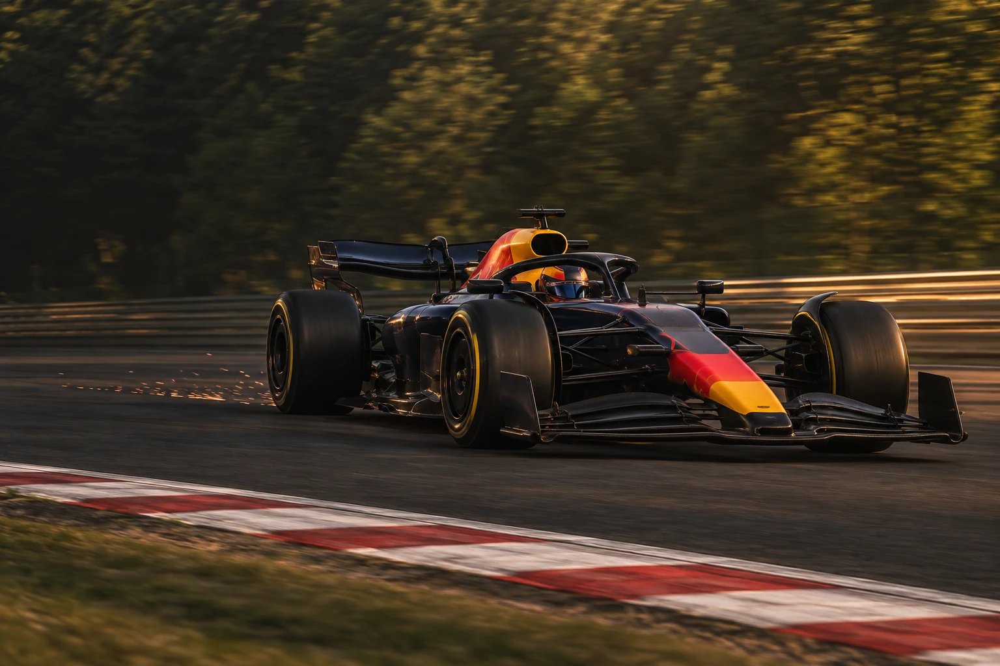

# Formula 25

Drive Max Verstappen’s No. 1 Oracle Red Bull Racing RB21 from the cockpit on all 24 circuits of the 2025 Formula 1 calendar. Standalone events and a saved drivers’ championship include 19 AI rivals and the six Sprint weekends.



## Run locally

Install Node.js 24 LTS and npm. The circuits, textures and fonts ship with the repository.

```sh
git clone https://github.com/aravhawk/formula-25.git
cd formula-25
npm ci
npm run dev
```

Open the local URL printed by Vite. Choose **First drive** to learn the controls or **Race** to line up on the grid. The game loads its assets over HTTP.

## Deploy to Vercel

Import the GitHub repository as a new Vercel project. Use the repository root, the **Vite** preset and Node.js **24.x**. The included configuration runs `npm ci`, builds with `npm run build` and serves `dist`. The app needs no API keys, server database or environment variables. Use the same production domain across releases so players keep access to their browser saves. The canonical link, the Open Graph and Twitter card tags and the JSON-LD in `index.html`, plus `public/robots.txt` and `public/sitemap.xml`, name `https://formula.aravhawk.com`. If you deploy under another domain, replace it in those files and in `test/metadata.test.js`. The 1200 by 630 share image is `public/og-image.jpg`, and its source is `scripts/og-image.html`. The apple-touch-icon and favicon are built from `scripts/icons.html` and `scripts/favicon-ico.mjs`. The game has one page and one language, so the sitemap lists one URL and there is no hreflang.

## Autosave and recovery

Choose **Resume race** in the garage to continue on the same device, browser profile and site. Qualifying, Sprint, first drive and championship sessions use the same save slot. Choose **Discard save** to clear the slot. Starting another drive asks before replacing it. **Save and return to garage** keeps the session. Resuming it in another tab transfers saving to that tab.

While driving, the game requests an IndexedDB checkpoint every half second. It records all cars, track positions, speeds, gearing, tyre and suspension state, damage, pit progress, lap and sector clocks, race order, assists and practice prompts. It also records the cockpit view state and available tyre marks. Pause, page hide and exit request an immediate save with a synchronous local-storage backup. On return, the race clock continues from the saved time.

Sudden power loss can recover only the last committed checkpoint. A busy disk, browser eviction, private browsing or clearing site data can reduce or erase recovery. If the browser refuses writes, the cockpit displays a warning. Saves stay on the device. A Vercel preview URL and the production domain have separate storage.

## Driving

Choose **First drive** for a guided solo run. The engineer follows your inputs through throttle, steering, braking and ERS deployment. You can replay it from the garage. Choose a venue and race distance. Start a Grand Prix from Verstappen’s 2025 grid slot or take a flying qualifying lap against the other drivers’ best recorded 2025 qualifying times. Sprint events use the 2025 Sprint grid. Championship progress saves after each classified race.

- W/A/S/D or arrows operate the pedals and steering.
- Q and E shift down and up. Paddle input selects manual mode. The pause menu can restore automatic shifting. At a standstill, R switches between reverse and first. Reverse is also available in the pause menu or by downshifting from first at a stop.
- Hold Shift to deploy ERS. Braking recovers energy.
- Hold Space for DRS. Enter an observed DRS zone within a second of another car from lap two. Qualifying allows free use within zones.
- B calls or cancels a pit stop. T selects the next compound. Pit entry, service and release are automatic once called.
- Full-distance Grands Prix require two dry tyre compounds. Monaco also requires two stops. The game applies a 30-second penalty for a missed requirement.
- Settings has traction control (Full, Medium, Off), anti-lock brakes and steering assist. With traction control off, too much throttle in a low gear spins the car. Lift and steer into the slide to catch it. With anti-lock off, a locked front axle will not turn.
- L toggles the racing line. F toggles fullscreen. Esc pauses. Touch is supported. The Controls screen lists every binding, and H shows them in the cockpit. Menus respond to arrows, Enter and Esc.
- Xbox and PlayStation controllers work over Bluetooth or USB. Pair the controller with the computer, then press any button in the game. Triggers are the pedals and the left stick steers. A (✕) deploys ERS, B (○) opens DRS, X (□) calls the pit and Y (△) picks tyres. The bumpers shift, D-pad up toggles the racing line and D-pad down selects reverse. Menu (Options) pauses and View (Create) shows the controls. Four vibration levels—Strong, Standard, Light and Off—shape engine, shifts, braking, cornering, slides, kerbs, surfaces and impacts; Xbox controllers in Chrome or Edge on Windows also rumble in the triggers. Fullscreen needs the keyboard or the Settings screen.

## Build and test the source

Use Node.js 22.12 or newer. Run these commands in the source directory.

    npm ci
    npm test
    npm run build
    npm start

The production preview listens on port 4173. The build in `dist` can also be served with `python3 -m http.server 8080 --directory dist`. The build writes `sw.js`, which caches every file for offline play.

## Data and simulation

### Circuits and opponents

The racing line, elevation, sector splits and observed DRS usage follow 2025 OpenF1 sessions. Baku and Las Vegas use practice data. The recorded lines are aligned to geographic circuit maps, with the driven path taking precedence where the layout diverges. AI pace follows the recorded speed trace. Calendar, grid and qualifying data come from Jolpica. Miami’s qualifying times use OpenF1’s Q1–Q3 session results because Jolpica omits those times. [OpenF1](https://openf1.org/) · [Jolpica](https://api.jolpi.ca/ergast/f1/2025.json)

Each venue has a terrain grid, a georeferenced 2025 Sentinel-2 mosaic and nearby OpenStreetMap building footprints. Building heights depend on map coverage. Road widths, roofs, facades, grandstands and kerbs are reconstructed. [Geographic data and imagery credits](public/licenses/landscape.txt)

### RB21 and race rules

The 120 Hz simulation resolves braking, traction and cornering at four contact patches, with four tyre-force substeps per tick. Gear spacing follows measured engine RPM and road speed. Each wheel samples surface grip, rolling resistance and temperature. Swept contact checks account for the chassis angle at the rails. Impacts affect aero efficiency and pit service time. Vehicle forces, battery capacity, pit paths and opponent behavior are gameplay approximations. [RB21 reference specifications](https://global.honda/en/F1/machine/2025_RedBullRB21/)

Races run in dry conditions. Qualifying compares the player's elapsed time to Verstappen's reference lap at the same station. Championship standings combine Grand Prix and Sprint points, with countback on Grand Prix results.

### Graphics

The game checks WebGPU presentation, with WebGL 2 and lightweight Canvas fallbacks. The 3D paths use environment lighting, local shadow maps and rear-facing scene capture. Adaptive resolution targets an 8.33 ms frame on high-refresh displays. The HUD reports average presented fps and the 95th-percentile frame interval.

## Project layout

| Directory | Contents |
| --- | --- |
| `src/` | Simulation, rendering, input and menus |
| `public/season/` | Event grids, circuits, reference laps and mapped buildings |
| `public/assets/` | Cockpit artwork, fonts, textures and environment maps |
| `scripts/` | Optional data generation and local release launchers |
| `test/` | Regression tests and the reference driver |

## Contributing and license

See [CONTRIBUTING.md](CONTRIBUTING.md) for development and bug reporting. Project code uses the [MIT license](LICENSE). Fonts, maps, datasets and third-party assets have their own [notices](public/licenses), including [circuit-specific imagery credits](public/licenses/landscape.txt).

Formula 25 is an independent fan project. Formula 1, team and driver marks belong to their respective owners.
